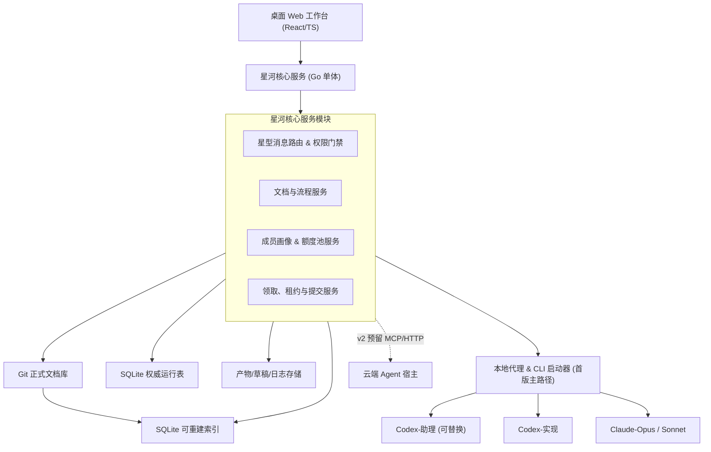
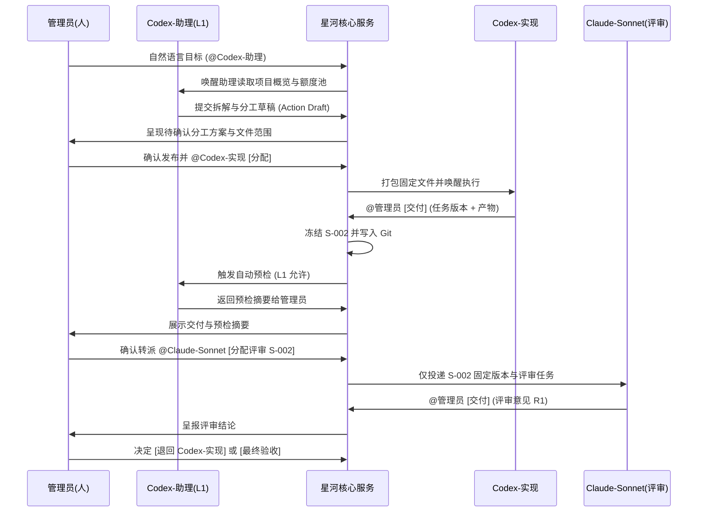

# 星河｜系统概要设计 v0.4

更新日期：2026-11-25（北京时间）  
对应需求：《星河｜需求文档 v0.5》  
状态：概要设计基线；核心产品边界、星型协议与存储分工已对齐，接口与实现待开发验证。  
版本说明：在 v0.3 基础上与需求 v0.5 对齐：确立「可视化工作台 + harness 协同框架」架构；新增星型消息路由（系统强制禁止成员互 `@`）、可替换管理员助理（初版默认 Codex CLI）及权限等级 L1/L2/L3、成员固定模型绑定与额度池模型；收敛首版实施至本地 CLI 能力分工闭环，将 PK（独立分支提 PR）与云端 MCP/HTTP 接入明确作为第二版预留扩展。保留原文件身份与历史版本。本文接口与表名均为星河拟议契约，并非上游产品原生 API。

## 1. 设计结论与架构边界

### 1.1 从存在理由推导的架构原则

大模型能力与成本的多样性，加上「厂家 harness + 厂家 LLM」组合在效果和订阅成本上的优势，决定了星河必须将 **Agent（harness + LLM）** 作为黑盒单位管理：

- **统一外围协同，不侵入内部 harness**：星河不重写 Agent 推理循环或工具编排，只通过**正式文件协议 + 星型消息接口 + 本地 CLI 适配层**与 Agent 交互。
- **核心系统零 LLM 依赖**：任务流转、权限校验、星型隔离、额度统计、版本提交与故障恢复全部由确定性程序完成。
- **管理员助理即普通成员**：助理不再是单独硬编码的协调框架，而是持有「管理员助理」任命文件的普通成员（**初版默认 Codex CLI**），与执行成员复用同一套接入与文件协议，随时可切换为 Claude Code、OpenCode 等任意成员。
- **可视化工作台是一等公民**：工作台面向管理员提供星型协作总览、能力分工依赖看板、任务文档与产物固定版本预览，以及可配置的助理确认流。

### 1.2 系统边界

- 成员执行方法、原生会话与内部工具由对应 harness 自行决定；跨厂家交接一律走固定版本的正式文件与产物清单。
- **星型拓扑硬约束**：服务端在 API 与暴露给成员的工具层强制限制，成员只能向管理员发送汇报/求助/交付，技术上无法 `@` 其他成员或读取未授权成员的消息。
- **单一事实源**：正式业务约定、分工、交付与验收以 **Git** 为准；成员身份、额度池、助理权限配置、星型消息、租约、Run、幂等与实际消耗以 **SQLite 权威表** 为准；文档列表与搜索索引为 **SQLite 只读投影**；大产物独立存储。
- Task 为顶层业务对象，不设 Project、Workspace 业务层；首版单服务、单正式 Git 写入者。
- 实施建议：后端优先 Go 单体服务，前端 React + TypeScript；首版落地本地 CLI（Codex CLI、Claude Code）闭环，PK（独立分支提 PR）与云端接入作为第二版扩展。

## 2. 系统总体结构



说明：

- `Codex-助理` 与 `Codex-实现`、`Claude-Opus` 走同一条本地代理与文件协议通道，区别仅在于所持**任命文件**与服务端授予的**助理权限等级**。
- SQLite 权威表与投影表可存于同一数据库文件，但写入职责、表前缀与恢复策略严格分离。

| 模块 | 主要职责 |
|---|---|
| Web 工作台 | 三栏可视化界面：成员/额度池/子任务、星型协作流/分工视图/任务文档、产物与固定版本预览、助理 L1 确认流 |
| 星型消息路由 | 处理管理员 5 类指令与成员 3 类回报；强制阻断成员间互 `@`；执行静态进度直答（不唤醒 CLI） |
| 助理权控门禁 | 维护助理成员绑定与权限等级（L1/L2/L3）；管理助理起草的待确认动作草稿（Action Draft） |
| 文档与流程服务 | 任命/任务草稿管理、字段保护、依赖检查、任务发布、评审/返工任务生成与正式 Git 串行发布 |
| 成员与额度池服务 | 管理 1 成员 = 1 harness + 1 固定模型配置、能力标签/历史表现画像、共享额度池窗口与手动校准 |
| 领取与提交服务 | 原子领取、租约与 `lease_epoch` 校验、产物收取哈希计算、冻结交付与取消门禁 |
| 待办与唤醒器 | 根据正式动作与唤醒指令生成可去重待办；低频按需唤醒本地 CLI，不持续轮询聊天 |
| 本地代理 & CLI 启动器 | 适配 Codex CLI、Claude Code（及可选 OpenCode）；准备隔离上下文包、进程树启停、日志与用量采集 |
| 存储层 | Git 正式文档库 + SQLite 权威表 + SQLite 投影表 + 内容寻址产物与草稿目录 |

## 3. 文档模型与存储布局

### 3.1 两类核心业务文档

1. **角色任命文件**：定义“某成员以何种职责、方法论与边界参与协作”，覆盖 `assistant`（管理员助理）、`architect`、`implementer`、`reviewer` 等角色。
2. **任务文件**：定义“本次做什么、为什么派给该成员、允许改哪些文件、输入与验收是什么、当前进度与最终结果”。评审任务复用任务格式，通过 `kind: review` 区分。

### 3.2 推荐目录布局

Git 正式文档库与 Agent 实际修改的业务代码仓库分开管理：

| Git 路径 | 内容 |
|---|---|
| `roles/{role_id}.md` | 可复用角色模板与方法论 |
| `appointments/{appointment_id}.md` | 正式任命（含助理任命）；历史由 Git 维护 |
| `tasks/{task_id}/task.md` | 任务约定、分派理由、文件范围、进度里程碑、结果与 `business_state` |
| `tasks/{task_id}/reports/{report_id}.md` | 正式长报告、评审意见与验证说明 |
| `tasks/{task_id}/submissions/{submission_id}.json` | 不可变交付清单，锚定任务版本与产物哈希 |
| `changes/{operation_id}.json` | 正式发布、交付、退回、验收、取消等业务变更审计记录 |

Git 之外的本地存储：

| 位置 | 内容与职责 |
|---|---|
| `runtime.sqlite` | 权威运行表（成员、额度池、消息、Run、租约、幂等、助理草稿）与可重建投影表 |
| `drafts/{task_id}/{run_id}/` | 成员工作草稿、自动保存与候选产物 |
| `objects/{sha256}/` | 已收取冻结的大产物字节 |
| `logs/{run_id}/` | CLI 原始输出日志与诊断信息 |
| 安全凭据存储 | 可选 API Key 或远端 Token 引用，不进入 Git 或常规日志 |

### 3.3 写入与隔离边界

- 成员只在受控草稿区或分配的代码范围中工作，正式文档由星河核心服务统一校验权限与基线版本后串行提交 Git。
- 成员通过接口读取被明确授权的文档，不默认访问整个 Git 正式文档库；星型隔离由服务端读权限与上下文打包器实施。

## 4. 文档契约

### 4.1 任命文件示例

```yaml
---
schema_version: 1
document_type: appointment
appointment_id: A-assistant-codex
revision: 1
member_id: "c1a84b20-5e32-4c11-8d0a-112233445566"
role: assistant
issued_by: admin
scope: workspace_overview_and_drafts
---
```

正文固定包含：职责、方法与原则、权限边界（注明：实际动作受服务端权限等级 L1/L2/L3 约束，任命正文不能自行扩权）、输出规范、停止与升级条件。

### 4.2 任务文件示例

```markdown
---
schema_version: 1
document_type: task
task_id: T-012.2
parent_task_id: T-012
revision: 5
kind: execute
owner_member_id: "9d55bc6d-9c8f-4f2c-94f8-90852d4a2b31"
assign_reason: "多文件代码修改表现稳定；与评审方 Claude-Sonnet 异构"
appointment_ref: {document_id: A-implementer, repo_id: xinghe-docs, commit_id: "<固定commit>", path: appointments/A-implementer.md}
file_scope:
  - "auth/session.ts"
  - "auth/lock.ts"
  - "auth/session.test.ts"
spec_revision: 2
business_state: submitted
run_id: R-003
inputs:
  - {document_id: S-001, repo_id: xinghe-docs, commit_id: "<固定commit>", path: tasks/T-012.1/submissions/S-001.json}
acceptance_owner: admin
---

# 实现 token 刷新

## 目标与范围
按 S-001 方案实现单飞刷新；仅修改 `file_scope` 约定文件，不改动 UI 层。

## 输入与验收要求
依据固定方案版本；并发仅触发一次刷新，refresh 过期清理当前端会话并跳登录页；测试通过并附证据。

## 流程、约束与决策
提交后由管理员转派异构评审；最多修订两轮；14:37 管理员补充确认仅清当前端会话。

## 进度
- 14:24 已定位过期处理入口
- 14:31 完成核心锁与刷新逻辑
- 14:44 补齐过期分支与单测，提交交付

## 结果与验证
19/19 单元测试通过；详见交付清单 S-002。

## 产物
引用 S-002 中的代码 diff、固定代码引用与测试输出。

## 遗留与下一步
待管理员预检与转派评审。
```

`task_id`、`owner_member_id`、`appointment_ref`、`file_scope`、`spec_revision`、`business_state` 与 `acceptance_owner` 均为受保护字段，仅允许管理员授权动作变更。文件所属 commit 由读取响应返回，不写入文件自身。

### 4.3 交付清单（Submission）

`submissions/{submission_id}.json` 记录：`submission_id`、`task_id`、`task_revision`、`spec_revision`、`appointment_ref`、`run_id`、`member_id`、`instance_id`、`lease_epoch`（历史证据）、`input_refs`、`artifact_refs`（含大小、类型、服务端计算的 sha256 或固定代码 commit/patch）、`outcome`（`completed`/`partial`/`blocked`/`failed`）、`submitted_by`、`submitted_at`、`command_id` 与结构校验结果。

## 5. 星型沟通协议与可替换助理机制

### 5.1 星型消息路由与强制隔离

所有群组消息落入 `messages` 权威表，包含 `message_id`、`task_id`、`sender_type`（`admin`/`assistant`/`member`）、`sender_member_id`、`target_member_id`（`admin` 或单一成员 UUID）、`directive_or_report_type`、`body`、`doc_refs`、`action_draft_id` 与 `created_at`。

服务端强制路由规则：

| 发送方 | 允许目标 | 允许类型 | 服务端强制行为 |
|---|---|---|---|
| `admin` | 任意成员 UUID（可分别批量发送） | `assign`、`inquire_static`、`inquire_wake`、`supplement`、`return`、`cancel` | 校验目标有效；`inquire_static` 直接读取任务文件 + `runs` 状态生成系统答复，**不产生 CLI 唤醒**；其余按需生成正式文档变更或唤醒待办 |
| `assistant` | `admin`（或 L2+ 规则允许的成员） | `draft_proposal`、`precheck_summary`、`static_report`；L2+ 可代发 `assign`/`inquire_wake` | **L1 模式下对成员的正式指令一律拦截并转为待确认草稿**；发给管理员的摘要标注 `via_assistant` |
| `member` | **仅允许 `admin`** | `deliver`、`report`、`help_block` | 若目标为其他成员，**直接返回 `forbidden_cross_member`**；成员端工具集不暴露 `@其他成员` 参数 |

### 5.2 上下文打包器（Context Pack）

每次唤醒成员时，星河按严格边界生成只读上下文包注入/挂载给该成员：

1. 成员自身生效的任命文件固定版本；
2. 当前任务文件及 `inputs` 中明确引用的固定交付/报告；
3. **仅包含该成员与管理员之间（围绕本任务）的历史指令与回报**；
4. 明确排除其他成员的消息、草稿与未引用任务文档。

### 5.3 助理角色切换与权限等级实现

- **角色即绑定**：数据库 `assistant_policies` 记录当前担任助理的 `member_id`、`appointment_ref` 和 `permission_level`（`L1`/`L2`/`L3`）。切换助理（例如从 `Codex-助理` 换为 `Claude-Sonnet` 或 `OpenCode-DS`）只需发布新任命并更新绑定，无需修改任何编排代码。
- **动作草稿（Action Draft）机制**：助理在 L1 权限下调用工具提出“拆分子任务”“分配给成员”“退回返工”时，服务端将其保存为 `assistant_action_drafts`（状态 `pending_confirm`）并呈现在工作台协作流中；仅当管理员点击确认后，才由核心服务执行正式 Git 发布与下游唤醒。
- **核心脱耦**：即使没有配置任何助理或助理 CLI 不可用，工作台直接调用核心接口完成建任务、发指令、验收与退回。

### 5.4 星型执行与异构评审时序



## 6. 状态、权限与正式提交

### 6.1 双状态模型

| 维度 | 字段 | 状态值 | 权威来源 |
|---|---|---|---|
| 正式业务阶段 | `business_state` | `published`、`submitted`、`reviewing`、`needs_revision`、`awaiting_acceptance`、`accepted`、`cancelled` | Git 任务文件与 `changes/` |
| 实际执行状态 | `runs.run_state` | `queued`、`starting`、`running`、`blocked`、`stopping`、`exited`、`failed`、`unknown` | SQLite `runs` 与 `task_leases` |
| 派生展示状态 | UI 计算 | 可领取、等待依赖、阻塞待澄清、发布同步中 | 由上两者实时派生，不可直接写 |

### 6.2 写入权限矩阵

| 操作 | 管理员（人） | 管理员助理（L1 默认） | 当前承办成员 | 评审成员 |
|---|---|---|---|---|
| 发布任命、任务约定、文件范围 | 允许 | 仅生成待确认草稿 | 可提建议 | 可提建议 |
| 保存草稿、汇报里程碑、求助 | 允许查看 | 静态读取 | 租约与版本有效时允许 | 仅自己的评审任务 |
| 正式提交交付 | 依规则代交留痕 | 不允许代交成果 | 当前 Run 与租约有效时允许 | 提交自己的评审结论 |
| 覆写已提交交付 | 不允许（新版本） | 不允许 | 不允许 | 不允许 |
| 退回返工 / 最终验收 | **唯一决策者** | 仅给预检与建议 | 禁止自审自验 | 提交评审结论，无最终验收权 |

### 6.3 正式提交与取消流程

1. 成员发起 `deliver`（submit），携带 `base_commit`、预期 `revision`、`spec_revision`、`run_id`、`lease_epoch` 与幂等键。
2. 核心服务在数据库事务中核验授权、Run 与租约，创建 `commands` 门禁记录。
3. 收取并哈希验证产物字节，拒绝缺失、仍在写入或越权文件。
4. 串行执行第 9.4–9.5 节的 Git 发布与数据库收尾对账，完成后再向管理员推送交付消息并按配置触发助理预检。
5. 取消请求先在数据库落盘阻断新领取并尝试停止进程树，再通过同一发布管线写 Git `cancelled` 结论；业务取消与进程停止分别呈现。

## 7. 能力分工、流程模板与代码隔离

### 7.1 固定流程模板

| 模板 | 分期 | 流转规则 |
|---|---|---|
| 单任务 | 首版 | 分配 → 交付 → 预检 → 管理员验收 |
| 接力 | 首版 | 前序交付经管理员验收（或 L2 放行）后，绑定固定 `submission_id` 分配给下游 |
| 多角色并行 | 首版 | 拆分为文件范围互不重叠的子任务并行执行，分别交付管理员汇总 |
| 执行 + 异构评审返工 | 首版 | 管理员将固定 `submission_id` 分配给不同模型/harness 成员评审；结论回传管理员后决定退回或验收 |
| PK（分支 + PR 对比） | 第二版 | 冻结共同输入与评测标准；各竞争成员在独立 Git 分支实现并提 PR；提交前相互不可见 |
| 融合 | 第二版 | 新建融合任务引用获选 PR/交付与评测依据，不覆盖原方案 |

### 7.2 代码仓库冲突策略

- **首版常规协作**：在任务拆解与确认阶段明确各子任务的 `file_scope`（修改文件范围），靠分工避免多成员同时编辑同一批文件；提交校验可提示超出 `file_scope` 的改动文件供管理员审阅。
- **第二版 PK 隔离**：每个竞争子任务绑定独立工作分支（配合独立目录或 git worktree），产出对应 PR 与固定 commit 哈希；由管理员统一发起异构对比评测。

## 8. 成员模型、额度池与执行权

### 8.1 成员与能力画像

- **首版硬规则**：`1 member = 1 harness + 1 fixed model + runtime_config`。例如：`Codex-助理 (codex-cli / gpt-5)`、`Codex-实现 (codex-cli / gpt-5)`、`Claude-Opus (claude-code / opus)`、`Claude-Sonnet (claude-code / sonnet)`。
- 能力画像由两部分组成：
  - **人工标签**：如“架构设计”“多文件重构”“代码评审”“单测补全”；
  - **历史统计视图**：从正式验收与评审记录汇总该成员的按类完成率、一次通过率与平均返工轮次，供管理员与助理分派参考。

### 8.2 额度池模型

- `quota_pools` 独立建表，支持两类计费形态：
  - `window_subscription`（如 Claude Max / ChatGPT Pro 5 小时窗口与周窗口）：记录窗口长度、重置时间、估算消耗百分比、最近校准时间与来源。
  - `pay_as_you_go`（如 DeepSeek API）：记录预算上限、累计估算/实测金额与币种。
- 多个成员通过 `members.quota_pool_id` 共享同一额度池。每次 Run 结束写入 `usage_records`（记录耗时、调用轮次及 CLI 可解析的 token/用量；无法获取时标 `unknown`），并允许管理员一键手动校准当前池余量。

### 8.3 原子领取与防旧写

- 同一任务的执行权由 SQLite 事务在 `task_leases` 原子授予，持久化 `task_id`、`run_id`、`instance_id`、`lease_epoch`（单调递增）和到期时间。
- 续租、汇报关键进度与交付均严格校验当前 `run_id` 与 `lease_epoch`；旧进程迟交的结果归档入历史候选区，绝不覆盖当前正式交付。
- 发生未确认停止的外部副作用任务时，默认先核实进程状态，不因短暂超时自动拉起第二个写操作实例。

## 9. Git 与数据库的数据责任

### 9.1 唯一权威来源与数据归属矩阵

每个业务字段只有唯一可写权威来源：

| 业务对象或字段 | 权威来源 | 存储位置 | 写入与派生规则 |
|---|---|---|---|
| 角色模板、任命正文与版本 | Git | `roles/`、`appointments/` | 授权发布；索引只读投影 |
| 任务目标、分派理由、`file_scope`、验收标准 | Git | `tasks/{id}/task.md` | UI/助理确认修改均走 Git 发布 |
| 正式里程碑、结果报告、评审意见、交付清单、验收/退回结论 | Git | `task.md`、`reports/`、`submissions/`、`changes/` | 仅授权业务动作追加 |
| `business_state` 正式业务阶段 | Git | `task.md`、`changes/` | `task_index` 只镜像，禁止直接 UPDATE |
| 成员 UUID、harness/固定模型配置、能力标签、启停 | SQLite 权威表 | `members`、`member_profiles` | 成员服务维护；归档不删历史关联 |
| 额度池配置、共享绑定、消耗计量与手动校准 | SQLite 权威表 | `quota_pools`、`usage_records` | 额度服务维护，独立备份 |
| 助理当前绑定成员、权限等级（L1/L2/L3）与待确认草稿 | SQLite 权威表 | `assistant_policies`、`assistant_action_drafts` | 权控门禁实时校验 |
| 星型群组消息、指令、回报与静态询问答复 | SQLite 权威表 | `messages` | 正式变更消息关联 Git `commit_id` |
| 连接授权、实例心跳、Run 状态、租约、epoch、幂等、待办 | SQLite 权威表 | `connections`、`instances`、`runs`、`task_leases`、`commands`、`outbox`、`runtime_audit` | 运行与调度服务事务维护 |
| 文档目录、任务看板、引用依赖、全文检索 | SQLite 投影表 | `document_index`、`task_index`、`link_index`、`artifact_index`、`fts`、`projection_checkpoint` | 仅投影器从 Git 重建，带源 commit |
| 代码快照、长日志、大产物、草稿 | 仓库/对象存储/本地目录 | 代码仓库、`objects/`、`drafts/`、`logs/` | 正式成果以哈希登记入 Git 清单 |

### 9.2 SQLite 逻辑表边界

**必须独立备份的权威表：**

| 表名 | 核心字段 | 核心约束 |
|---|---|---|
| `quota_pools` | `id`, `name`, `pool_type`, `window_spec`, `budget_limit`, `used_estimate`, `reset_at`, `calibrated_at` | 共享额度源，支持手动校准 |
| `members` | `id`, `display_name`, `harness_type`, `fixed_model`, `quota_pool_id`, `runtime_config`, `enabled`, `archived_at` | UUID 稳定；首版 1 成员固定 1 模型 |
| `member_profiles` | `member_id`, `tags_json`, `stats_json`, `updated_at` | 人工能力标签 + 历史验收汇总 |
| `assistant_policies` | `id`, `member_id`, `appointment_ref`, `permission_level`, `auto_precheck`, `updated_at` | 控制助理绑定与 L1/L2/L3 权限 |
| `assistant_action_drafts` | `id`, `assistant_member_id`, `task_id`, `action_type`, `payload_json`, `state`, `confirmed_by`, `command_id` | L1 确认门禁，未确认不生效 |
| `messages` | `id`, `task_id`, `sender_type`, `sender_member_id`, `target_member_id`, `msg_kind`, `body`, `refs_json`, `created_at` | 星型拓扑硬校验（禁止成员↔成员） |
| `connections` / `connection_grants` | `id`, `token_hash`, `member_id`, `scope`, `permissions`, `enabled` | 凭据不入 Git；撤销立即生效 |
| `instances` | `id`, `member_id`, `connection_id`, `location`, `last_seen_at`, `capabilities` | 区分本地与 v2 云端实例 |
| `runs` | `id`, `task_id`, `spec_ref`, `member_id`, `instance_id`, `run_state`, `process_identity`, `session_ref`, `times` | 每次重试/返工新建 Run |
| `task_leases` | `task_id`, `run_id`, `instance_id`, `epoch`, `expires_at`, `service_generation` | `task_id` 唯一；`epoch` 单调不归零 |
| `commands` | `id`, `principal_id`, `idempotency_key`, `payload_hash`, `action`, `task_scope`, `state`, `base_head`, `candidate_commit`, `published_commit` | 跨存储发布对账与幂等门禁 |
| `outbox` | `id`, `cause_id`, `target`, `action`, `ref`, `status`, `attempts`, `next_at` | 因果键唯一，只传引用不重做业务 |
| `usage_records` | `id`, `run_id`, `member_id`, `quota_pool_id`, `source`, `duration_ms`, `units`, `cost`, `observed_at` | 未知费用显式标记 |
| `runtime_audit` | `id`, `actor`, `instance_id`, `command_id`, `event_type`, `evidence`, `created_at` | 安全、拦截与运行审计 |

**允许删除并从 Git 重建的投影表：** `document_index`、`task_index`、`link_index`、`artifact_index`、`business_history_index / FTS`、`projection_checkpoint`。索引重建严禁清空权威表；权威表不得以投影表为唯一外键目标；关键发布与验收动作必须核验正式 Git 版本。

### 9.3 Git 正式发布、跨存储一致性与备份

1. **串行发布**：成员草稿执行并行，正式 Git 分支更新由核心服务串行化，采用预期旧 head 检查（`git update-ref` 语义）防止覆盖未知提交；无关任务的提交不制造虚假业务冲突。
2. **五步发布对账（Git + SQLite 无共享事务）**：
   - **准备**：数据库事务校验权限、租约、幂等键并写入 `commands` 门禁。
   - **收取**：收取验证产物字节，生成候选文档与 `candidate_commit` 并落库。
   - **发布**：再次校验门禁，以预期旧 head 更新正式分支，同 commit 包含正文、交付清单与 `changes/{operation_id}.json`。
   - **收尾**：数据库事务写入 `published_commit`、更新投影与 checkpoint、写唯一因果键 `outbox`、完成 command、释放门禁。
   - **推进**：仅对已完成对账的正式提交投递通知或触发下游。
3. **崩溃与冲突恢复**：
   - 同文档旧版本写入返回 `version_conflict`，禁止静默覆盖。
   - 发布结果不明时先检查 `candidate_commit` 在正式历史的可达性与 `operation_id`，已入历史则补齐收尾，未入历史则安全重试或终止。
   - 恢复旧数据库备份后生成新 `service_generation`，使旧租约全部失效，核实在途进程后再恢复派工。
4. **完整备份**：必须同时覆盖 **Git 对象与引用 + SQLite 权威表 + 交付引用的大产物**，不能将索引重建等同于完整备份。

## 10. 内部接口与工具访问契约

以下契约可映射为 Go 服务接口、Web HTTP API 与本地/v2 云端 MCP 工具；服务端按身份严格裁剪可用接口集合（成员侧仅暴露执行与向管理员回报所需子集）：

| 操作 | 调用方 | 权威写入 | 核心约束 |
|---|---|---|---|
| `member.upsert` / `quota_pool.upsert` / `quota_pool.calibrate` | 管理员 | SQLite | 成员固定模型绑定、能力标签、额度池校准 |
| `assistant.configure` | 管理员 | SQLite + Git 任命 | 切换助理成员、设置 L1/L2/L3 权限等级 |
| `assistant.propose_draft` | 助理 | SQLite | L1 下写入 `assistant_action_drafts`，不直接生效 |
| `assistant.confirm_draft` | 管理员 | Git + SQLite | 确认后执行正式发布/分配 |
| `message.send_directive` | 管理员（及 L2+ 助理） | SQLite（必要时触发 Git） | 5 类指令；`inquire_static` 直读文件与 Run 不唤醒 CLI |
| `message.report_to_admin` | 成员 | SQLite（交付走 Git） | 3 类回报；服务端硬禁止目标为非管理员 |
| `appointment.publish` / `task.publish` | 管理员 | Git + SQLite command | 校验受保护字段与基线 commit |
| `document.read` / `context_pack.fetch` | 管理员/助理/成员 | 无 | 严格执行星型读隔离，成员仅读授权文件 |
| `task.claim` / `task.renew` | 执行代理 | SQLite | 原子领取与 `lease_epoch` 校验 |
| `artifact.upload` | 执行代理 | 字节存储 | 完整性与哈希验证，尚未成为交付 |
| `task.deliver` | 承办成员 | Git + SQLite 收尾 | 冻结交付清单、触发向管理员交付通知与可选预检 |
| `task.accept` / `task.return` / `task.cancel` | 管理员 | Git + SQLite | 验收/退回/取消，区分业务结论与进程停止 |
| `task.list` / `message.list` / `run.reconcile` | 管理员/系统 | 无 / SQLite | 返回双状态、源 commit 与同步态 |

标准错误码至少包含：`unauthorized`、`forbidden_cross_member`、`assistant_confirmation_required`、`version_conflict`、`lease_lost`、`invalid_submission`、`file_scope_warning`、`input_changed`、`run_unknown`、`publication_pending`。

## 11. 唤醒、本地 CLI 适配与故障恢复

### 11.1 低频按需唤醒

- 仅当管理员下发 `assign`、`inquire_wake`、`supplement`（需续做）、`return` 或触发助理起草/预检时才生成唤醒待办。
- 普通草稿保存、心跳、一般汇报与 `inquire_static` 不唤醒任何 CLI。
- 唤醒载荷只携带 `task_id`、动作类型与上下文包引用，执行端通过 `claim` 获取执行权后再读取固定文件。

### 11.2 本地 CLI 最小适配层（首版核心）

针对 Codex CLI、Claude Code（及可选 OpenCode）分别实现轻量化 launcher：

- 能力探测与锁定版本检查、参数数组启动（严禁拼接任意模型文本进 shell）、工作目录与受控草稿区准备、进程身份登记（含启动时间/进程组，避免仅靠易重用 PID）、进程树可靠终止、退出码与可获取用量收集。
- **Windows 兼容作为一等验收要求**：在 Windows 上实测非交互调用、参数转义、UTF-8 编码、路径规范化与 Job Object / 进程树清理。
- 原生会话恢复仅作为同任务多轮续接的可选优化，正式交接与返工始终可在无原生会话条件下仅凭上下文包完成。

### 11.3 故障处理矩阵

| 场景 | 系统处理 |
|---|---|
| UI 关闭或断开 | 后台继续运行，重开后恢复正式业务阶段、执行状态与消息流 |
| 成员试图向另一成员发消息/交接 | 服务端返回 `forbidden_cross_member` 并记入 `runtime_audit` |
| 助理在 L1 权限下尝试直接发布或分配 | 拦截并转为待确认草稿，提示管理员审批 |
| 助理 CLI 离线或额度耗尽 | 管理员可一键切换其他成员任助理，或直接通过表单/按钮完成全部操作 |
| Git 已发布但数据库收尾失败 | 通过 `commands` 与 `candidate_commit` 对账补齐投影、消息关联与 `outbox` |
| 提交完成但客户端断连未收到响应 | 同幂等键返回既有正式交付，不重复提交或派工 |
| 启动意图已落库、进程确认前崩溃 | Run 置为 `unknown`，核实进程与工作区后再由管理员决定重试，禁止盲目重跑 |
| 旧实例租约失效后迟交成果 | 归档候选与原因，绝不覆盖当前正式交付 |
| 评审期间原实现成员修改工作区 | 评审严格绑定已冻结的 `submission_id`，新改动须走新一轮交付 |
| 索引损坏 vs 权威表损坏 | 索引从 Git 重建；权威表从备份恢复、升级 `service_generation` 并失效旧租约 |

## 12. 工作台 UI、权限与成本展示

- 严格对齐需求第 8 节与原型 `prototype/workbench.html`：左栏展示成员（harness/模型/状态/能力标签）、共享额度池（余量/重置倒计时/校准入口）与子任务；中栏提供**协作交互**（支持按成员筛选一对一通道，内置助理 L1 确认卡与 5 类指令发送栏）、**任务流**（双状态徽标 + 分派理由 + `file_scope` + 依赖连线）与**任务文档**；右栏仅展示文档类产物（按方案/交付/评审/任命筛选）与固定版本 Markdown 预览。
- 本地部署默认监听 loopback；第二版开放远程与 PWA 访问时再启用认证、TLS 与细粒度下载授权。
- 成本与额度面板分别展示订阅池估算进度与可观测 API 费用；未知成本显式标示「未知/待校准」。

## 13. 技术选型与分阶段交付

| 阶段 | 交付内容 | 验证门槛 |
|---|---|---|
| **P0 协议与双 CLI 验证** | 任命/任务模板、Codex CLI & Claude Code 非交互启动与停止（含 Windows）、Git/SQLite 对账小样 | 两类 CLI 可按上下文包交付文件；Git 发布与数据库收尾间断电/中断可恢复 |
| **P1 星型闭环与工作台骨架** | 三栏桌面工作台、成员固定模型与共享额度池、星型 5+3 消息协议、静态查进度、Codex 助理 L1 确认流 | 成员互 `@` 被服务端硬拦截；静态查进度 0 CLI 唤醒；L1 未确认不生效 |
| **P2 能力分工与异构评审** | 子任务拆解、分工依赖视图、`file_scope` 标注、跨 harness 接力、并行分工与异构评审返工 | Claude 方案 → Codex 实现 → Claude 异构评审 → 返工/验收全链路可追溯 |
| **P3 助理切换与可靠性加固** | 助理热切换（Codex ↔ Claude/OpenCode）、租约防旧写、崩溃恢复、幂等与完整备份恢复 | 切换助理零代码改动；无助理可用；旧实例迟交与重复通知不污染正式结果 |
| **P4（v2）PK 与云端接入** | PK 独立分支与 PR 对比评测、融合任务、L2 计划内流转、云端 MCP/HTTP 接入最小闭环 | 竞争成员提交前严格隔离；云端与本地遵循同一星型文件协议 |
| **P5（v2）移动端与扩展** | PWA 阅读/审批体验、远程安全入口、更多 Agent 与跨主机代理 | 移动端可完成阅读、预检审阅与验收拍板 |

## 14. 相对旧设计的演进迁移

| 旧设计（v0.3 及之前） | 本版设计（v0.4） |
|---|---|
| 协调角色绑定 OpenCode + DeepSeek | 助理抽象为可灵活替换的普通成员角色，**初版默认 Codex CLI**，并引入 L1/L2/L3 权限等级 |
| 中间区域完全去除群聊形态 | 采用**星型异步群聊（管理员视角总览）+ 文件核心流转**，系统强制禁止成员间直接 `@` |
| 成员未强制绑定固定模型，缺少额度池 | 首版 1 成员绑定 1 harness + 1 固定模型；新增共享**额度池**与能力画像 |
| 首版同时包含 PK 与云端 MCP 接入 | 首版收敛至本地 CLI 能力分工闭环；PK（独立分支提 PR）与云端接入明确划入第二版 |
| 常规代码隔离强调复杂自动工作树 | 首版靠任务分工与 `file_scope` 避免冲突；第二版 PK 再采用独立分支 + PR |

## 15. Runner 调研结论与参考

调研启发保留如下：角色与团队约定能有效组织独立 CLI Agent，本地代理负责会话与进程生命周期；共享明确材料即可协作，无需合并全量原生会话；消息送达或进程空闲不等同于交付完成或验收通过。Runner 仅作为机制参考，不将其总线或内部格式作为星河长期协议。

参考资料：

- [Runner 仓库](https://github.com/yicheng47/runner) / [Runner 架构](https://github.com/yicheng47/runner/blob/main/docs/arch/arch.md)
- [Git 快照与历史](https://git-scm.com/book/en/v2/Getting-Started-What-is-Git%3F) / [git-update-ref](https://git-scm.com/docs/git-update-ref) / [SQLite 事务](https://www.sqlite.org/lang_transaction.html)

## 16. 设计风险与待验证项

| 风险 | 应对与验证 |
|---|---|
| 成员试图绕过星型规则直接协作 | 成员工具集裁剪 + 服务端硬拦截 + 上下文包严格隔离 |
| 助理在 L1 模式下越权直接发任务 | 动作草稿门禁，仅管理员确认接口可触发正式发布与唤醒 |
| 频繁询问进度导致订阅额度浪费 | 默认静态直答（读任务文件 + Run 状态），唤醒询问设为显式二级动作 |
| 同项目并行修改引发代码冲突 | 首版在任务文件明确 `file_scope` 并在提交时校验提醒；第二版 PK 使用独立分支 + PR |
| 订阅额度无法自动获取精确官方余量 | 采用窗口规则 + 本地调用/耗时记录 + 手动校准，显式标注估算值 |
| Git 与 SQLite 跨存储状态不一致 | 持久化 `commands`、`candidate_commit`、串行发布与启动对账 |
| Windows 平台 CLI 启停与编码异常 | P0 阶段在 Windows 实机验证 Codex CLI 与 Claude Code 的启动、超时终止与产物收取 |

版本历史：

- **v0.4（2026-11-25）**：对齐需求 v0.5；确立黑盒 Agent 与可视化工作台定位；设计星型消息路由与禁止成员互 `@` 机制；将助理改为可替换普通角色（初版默认 Codex CLI）并引入 L1/L2/L3 动作草稿门禁；新增共享额度池、成员固定模型绑定、能力画像与 `file_scope`；收敛首版至本地 CLI 能力分工，将 PK（分支 + PR）与云端接入划入第二版。
- **v0.3（2026-11-25）**：确定 Git 正式版本与 SQLite 运行控制，明确权威表/投影表边界、双状态拆分与跨存储对账。
- **v0.2（2026-11-25）**：文档为核心，确立任命与任务分离、不可变交付、独立评审、租约唯一领取与 Go 实施建议。
- **v0.1（2026-11-02）**：初版 OpenCode + DeepSeek、CLI 桥接与文件存储构想。

本文是系统概要设计，不代表相关模块已经实现或通过集成验证。
